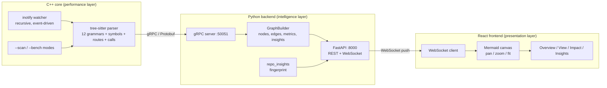

# CodeSight

**A live code-architecture observatory.** Point it at any GitHub repository or local folder and it clones, parses, and streams a real-time dependency graph — with symbols, API routes, call edges, impact analysis, risk scoring, and a repo fingerprint — straight to your browser.

[](https://github.com/Valton13/codesight/actions/workflows/ci.yml)
[](LICENSE)
[](https://github.com/Valton13/codesight/stargazers)

CodeSight is a hybrid **C++ / Python / React** system. A low-latency C++ core watches the filesystem and parses code with tree-sitter; a Python backend builds the dependency graph, computes metrics, and fingerprints the repository; a React frontend renders everything live over WebSockets. The two processes talk over **gRPC + Protocol Buffers**, not REST.

---

## What it does

- **Analyzes any public GitHub repo** (shallow clone) or any local folder.
- **Watches local folders live** — save a file, the graph updates in place.
- **Parses 12 languages** into symbols: classes, interfaces, structs, enums, traits, modules, functions, methods, constructors — with export flags and cyclomatic complexity.
- **Extracts API routes** (FastAPI/Flask, Express/Nest, Spring, Gin/Echo/Fiber, Rails, Laravel).
- **Resolves call edges** (function → function) with confidence labels, plus internal vs. external import edges.
- **Impact analysis**: click a file to trace *depends-on*, *used-by*, or *both*, with a depth slider and blast-radius risk.
- **Repo fingerprint**: language breakdown, frameworks, entry points, build/test/lint commands, CI, license, docs, monorepo, test + dependency counts.
- **Graph insights**: circular dependencies (Tarjan SCC), key files (PageRank), complexity hotspots, orphan files.
- **Risk heatmap** overlay combining complexity, fan-in, and test presence.
- **Exports**: SVG, PNG, and raw Mermaid source.
- **Tested + CI**: C++ parser fixtures via `ctest`, pytest for graph/insights/URL parsing, GitHub Actions build+test on every push.

---

## Architecture



| Layer | Responsibility | Port |
|---|---|---|
| C++ core | Filesystem events, AST parsing, symbols/routes/calls/imports | — |
| gRPC bridge | Type-safe binary IPC (`ParsedFile`) | `50051` |
| Python backend | Graph, metrics, insights, fingerprint, fan-out | `8000` |
| React frontend | Live rendering, controls, impact focus, exports | `5173` |

---

## Supported languages

Python, JavaScript, TypeScript, TSX, C, C++, Go, Java, C#, Rust, Ruby, PHP.
CSV/JSON/YAML/TOML/SQL/XML are recorded as data-asset nodes.

---

## Quickstart

Prereqs: Linux, GCC/Clang + CMake, `libgrpc++-dev` + `protobuf-compiler-grpc`, Python 3.11+, Node 20.19+/22.12+, git.

```bash
git clone https://github.com/Valton13/codesight.git
cd codesight
./scripts/fetch_grammars.sh          # third_party/ is fetched, not vendored

sudo apt-get install -y build-essential cmake libgrpc++-dev protobuf-compiler-grpc
cmake -S . -B build && cmake --build build -j"$(nproc)"

cd python
python3 -m venv venv && source venv/bin/activate
pip install -r requirements.txt
python -m grpc_tools.protoc -I. --python_out=. --grpc_python_out=. proto/codesight.proto
cd ../frontend && npm install && cd ..

./start.sh                            # or: ./start.sh /path/to/repo
```

Open http://localhost:5173. Stop with `./stop.sh`.

Manual run (3 terminals): `python server.py` (in `python/`, venv active); `./build/codesight ./test_project`; `npm run dev` (in `frontend/`).

---

## Usage

- **Analyze GitHub**: paste `https://github.com/owner/repo` → Analyze.
- **Analyze local**: Overview tab → Local folder → path → Scan.
- **Watch live**: `./build/codesight ./your-project`.
- **Impact**: click a file → Depends on / Used by / Both + depth slider.
- **Symbols**: View → Symbols: files / +types / +methods (call edges appear with +methods).
- **Risk heatmap**: View → Color by: risk.
- **Insights**: key files, cycles, hotspots, orphans.
- **Export**: canvas toolbar SVG / PNG / Copy Mermaid.
- Shortcuts: `/` focus URL, `Esc` exit focus/drawer/wide, wheel zoom, drag pan.

---

## Testing

```bash
cmake --build build -j"$(nproc)"
(cd build && ctest --output-on-failure)          # C++ parser + filter fixtures

cd python && source venv/bin/activate
pip install -r requirements-dev.txt
python -m pytest tests -q                        # graph / insights / URL parsing
```

CI (`.github/workflows/ci.yml`) runs C++ build + ctest, pytest, and frontend typecheck/build on every push and PR.

---

## Performance (reproducible)

```bash
./scripts/bench.sh                 # defaults to ./test_project
./scripts/bench.sh /path/to/repo 300
```

This runs the C++ parser in `--bench` mode (parse-only throughput) and measures Python graph construction, insight computation, overview fingerprinting, and WebSocket payload size. Results are written to `docs/metrics.json`. **Quote only numbers produced by this script on your machine.**

Measured quantities: C++ ms/file and files/sec; symbols/imports/routes/calls extracted; Python ingest ms, graph-build ms, overview ms, graph payload KB, resolved call edges, route count.

---

## Limits & configuration

| Setting | Value |
|---|---|
| Files per scan | 300 |
| Max file size parsed | 256 KB |
| WebSocket graph throttle | 250 ms |
| Clone depth / timeout | 1 / 120 s |
| Scan timeout | 300 s |
| Cached clones kept | 3 |

---

## Accuracy & limitations

- Import/call relationships are **static approximations**; dynamic imports, reflection, and DI can hide real edges. Call edges carry a confidence label.
- Filesystem watcher is **Linux-only** today (macOS/Windows on the roadmap).
- Export flags and complexity are per-language heuristics, not compiler-grade.

---

## Roadmap

Phase 3: git hotspots/ownership, coverage ingestion, PR/diff impact, commit-keyed snapshots, AI explainer + semantic search, security panel, Markdown/PDF/HTML reports.
Hardening: true incremental tree-sitter parsing, scale beyond scan cap (pagination/cache/queue), macOS/Windows watchers, in-graph search.

---

## License

MIT — see [LICENSE](LICENSE).

## Acknowledgements

tree-sitter and grammar authors, Mermaid, FastAPI, gRPC, React, Vite.
